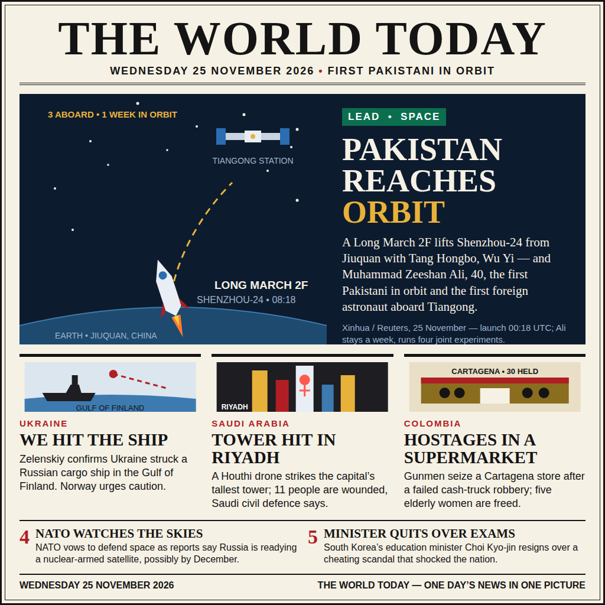

# THE WORLD TODAY — Wednesday 25 November 2026

[](https://make.fun/c/news-image-20261125)
[](https://make.fun/c/news-image-20261125)
[](https://make.fun/c/news-image-20261125)

Entry for the make.fun bounty [Sum up 25 November's world news in one image](https://make.fun/c/news-image-20261125).

## The image

A newspaper front page, **THE WORLD TODAY**, dated **WEDNESDAY 25 NOVEMBER 2026**,
summing up the day's world news in one picture.



## Stories pictured

- **Pakistan reaches orbit.** China's Shenzhou-24 lifts off from Jiuquan on a
  Long March 2F rocket at 08:18 Beijing time (00:18 UTC). Aboard: commander
  Tang Hongbo, flight engineer Wu Yi — and Muhammad Zeeshan Ali, 40, the first
  Pakistani in orbit and the first foreign astronaut to visit China's Tiangong
  space station. He stays about a week, running four joint experiments.
- **We hit the ship.** President Volodymyr Zelenskiy confirms Ukraine struck a
  Russian cargo ship in the Gulf of Finland; Norway urges caution in such
  operations.
- **Tower hit in Riyadh.** A Houthi drone strikes the Saudi capital's tallest
  tower; 11 people are wounded, Saudi civil defence says.
- **Hostages in a supermarket.** Gunmen seize a Cartagena supermarket after a
  failed cash-truck robbery, holding 30 people; five elderly women are freed.
- **NATO watches the skies.** NATO vows to defend space amid reports that
  Russia is preparing a nuclear-armed satellite, possibly as soon as December.
- **Minister quits over exams.** South Korea's education minister Choi Kyo-jin
  resigns over an exam-cheating scandal that shocked the nation.

The front page was duel-tested against two other layouts built the same morning
(a dark poster, "PAKISTAN REACHES ORBIT", and a light lead with a 2×2 story
grid). The broadsheet won: it leads with the day's most consequential story,
its rocket-and-station scene reads at a glance, every story carries its own
drawn visual, and it stays legible at ~300 px wide.

## How it runs

`main.ts` (Node 22, standard library only) copies `entry.png` to
`$MAKEFUN_OUTPUT_DIR/entry.png` (default `/output`), creating the directory
if needed. It takes no input and writes the same bytes on every run:

```sh
mkdir -p out && MAKEFUN_OUTPUT_DIR=out node main.ts
```

Deterministic: two runs write byte-identical files (same sha256), and the
image is 1024×1024 at 185,368 bytes, under the 1 MiB cap.

## Sources

- Xinhua / Reuters, 25 November 2026 — Shenzhou-24 launches from Jiuquan at
  08:18 Beijing time with Muhammad Zeeshan Ali, first Pakistani in orbit and
  first foreign astronaut aboard Tiangong.
- Reuters world news summary, 25 November 2026 — Zelenskiy confirms Ukraine hit
  a Russian ship in the Gulf of Finland; Houthis hit Riyadh's tallest tower,
  11 wounded.
- WH News / Reuters, 25 November 2026 — armed men take 30 hostages in a
  Cartagena supermarket; NATO vows space defence amid reports of a Russian
  nuclear satellite; South Korea's education minister resigns over an exam
  cheating scandal.
